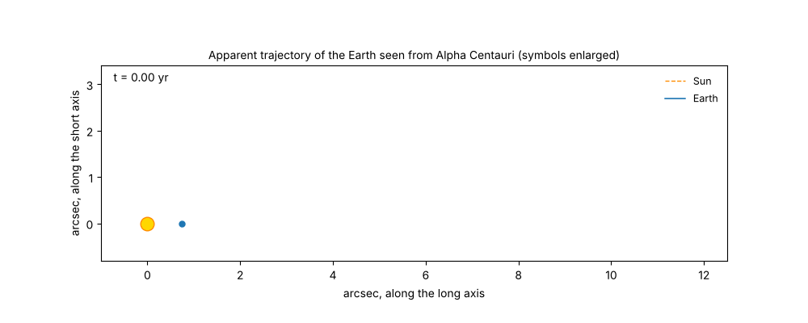

# Alpha-Centauri Observer

## Introduction
This project investigates whether an observer located in the Alpha Centauri system can detect and study the Earth-Moon system using astronomical instruments similar to, or more advanced than, those available today.
The analysis focuses on the main physical and observational challenges, including angular separation, reflected light, albedo, orbital geometry and instrumental limitations. It distinguishes between direct imaging, indirect detection and physical characterization, considering the different information each method can provide.
At a distance of approximately $1.34\, \mathrm{pc}$ ($4.37\, \mathrm{ly}$), the Earth-Sun separation would appear to be about $0.747\, \mathrm{arcsec}$. However, detecting the Earth next to the Sun is particularly challenging because the Earth is small, reflects little light and appears very close to the Sun.
The project also examines the possibility of detecting the Earth through transit photometry. Although an ideal edge-on configuration would produce a measurable transit signal in principle, the actual position of Alpha Centauri does not allow the Earth to transit across the Sun from that viewpoint.
Another objective is to reconstruct the Earth's apparent motion, considering both its orbital motion and the relative proper motion of the stellar systems. Finally, the project explores the possibility of atmospheric characterization through spectroscopy, focusing on features associated with oxygen ($\mathrm{O_2}$), ozone ($\mathrm{O_3}$), and methane ($\mathrm{CH_4}$).
Overall, the possibility of observing the Earth from Alpha Centauri cannot be answered with a simple yes or no. It depends on what is meant by observation, on the geometry of the system, on the physical properties of the observed bodies, and on the instruments available. Direct imaging, transit photometry, astrometric measurements, and atmospheric spectroscopy provide different types of information and are affected by different limitations.

## System definition and physical parameters
Before asking what an observer could see, the observer and the observed object have to be defined. The observer was placed in the Alpha Centauri system, and the object of study is the Earth-Moon pair orbiting the Sun. The distance of Alpha Centauri is about $2.76\times10^5\,\mathrm{AU}$, while the two main stars, A and B, are separated by only a few tens of AU. For every order-of-magnitude estimate below, the exact position of the observer inside the system is therefore irrelevant, and the values for the barycentre of the system were used throughout. 

The parallax of the barycentre is $\pi=747.17\pm0.61\,\mathrm{mas}$ (Kervella 2017), which gave a distance $\displaystyle d=\frac{1} {\pi}=1.338\,\mathrm{pc}$, or $4.364\,\mathrm{ly}$. The proper motion is $\mu_\alpha=-3619.9\pm3.9\,\mathrm{mas\,yr^{-1}}$ in right ascension (the $\cos\delta$ factor was already included) and $\mu_\delta=+693.8\pm3.9\,\mathrm{mas\,yr^{-1}}$ in declination, and the radial velocity is $-22.332\pm0.005\,\mathrm{km\,s^{-1}}$, the minus sign meaning that the system is approaching the Sun. 
For Alpha Centauri A alone, the distance is about $1.332\,\mathrm{pc}$, a difference of roughly $0.5\%$, which does not change any conclusion. The sky position was taken to be that of Alpha Centauri A (J2000): $\alpha=14^{\mathrm h}\,39^{\mathrm m}\,36.494^{\mathrm s}=219.902^\circ$ and $\delta=-60^\circ\,50'\,02.37''=-60.834^\circ$. It is needed later to compute the ecliptic latitude of the observer.

For the Sun the nominal values $R_{\odot}=695\,700\,\mathrm{km}$ and $GM_{\odot}=1.32712\times10^{20}\,\mathrm{m^3\,s^{-2}}$ were used (IAU 2015). The mean radii are $R_{\oplus}=6371\,\mathrm{km}$ and $R_{\mathrm{Moon}}=1737.4\,\mathrm{km}$, and a mean Earth-Moon distance of $384\,400\,\mathrm{km}$ (NASA Moon Fact Sheet). The reflectivity of a body is described by the geometric albedo $A_g$, the ratio between the brightness of the body at full phase and that of a flat Lambertian disc of the same size. For the Moon $A_g=0.12$ was adopted. For the Earth two values were used: $0.242$ (Robinson 2026) and $0.367$ (Cox 2000). They bracketed the uncertainty, and the conclusions did not depend on which one was chosen. 

The basic tool for converting a physical size into what the observer sees was the small-angle relation. By definition of the parsec, an object of size $s$ at a distance $d$ subtends an angle 

$$\theta\,[\mathrm{arcsec}]=\frac{s\,[\mathrm{AU}]}{d\,[\mathrm{pc}]}$$

Applying it gives the angular scale of the whole problem. The Sun-Earth separation of 1 AU appears as $747\,\mathrm{mas}$, which is not tiny by the standards of modern telescopes. The Earth-Moon distance shrinks to only $1.92\,\mathrm{mas}$. The Sun has an angular diameter of $6.95\,\mathrm{mas}$, the Earth of $0.064\,\mathrm{mas}$ and the Moon of $0.017\,\mathrm{mas}$, so both planetary bodies are point sources for any conceivable instrument.

| Object | Size | Angle seen from Alpha Centauri |
|---|---|---|
| Sun-Earth distance | 1 AU | $747\,\mathrm{mas}$ |
| Earth-Moon distance (mean) | $384\,400\,\mathrm{km}$ | $1.92\,\mathrm{mas}$ |
| Sun (diameter) | $1.39\times10^6\,\mathrm{km}$ | $6.95\,\mathrm{mas}$ |
| Earth (diameter) | $12\,742\,\mathrm{km}$ | $0.064\,\mathrm{mas}$ |
| Moon (diameter) | $3475\,\mathrm{km}$ | $0.017\,\mathrm{mas}$ |

Brightness is expressed in magnitudes, with

$$m_1-m_2=-2.5\log_{10}\left(\frac{F_1}{F_2}\right)$$

$$m=M+5\log_{10}\left(\frac{d}{10\,\mathrm{pc}}\right)$$

With an absolute V magnitude $M_V=4.83$ for the Sun, the Sun seen from Alpha Centauri has an apparent magnitude $m_{\odot}=0.46$, about as bright as Alpha Centauri A appears to us. This is the glare against which the Earth has to be detected.

## Angular resolution
The first requirement for seeing two objects as separate is that the telescope can tell them apart. Because of diffraction, a point source observed through a circular aperture of diameter $D$ does not form a point in the image, but the Airy pattern

$$\frac{I(\theta)}{I_0}=\left[\frac{2J_1(x)}{x}\right]^2$$

where $J_1$ is the Bessel function of the first kind. The central peak is surrounded by faint rings, and the first dark ring falls at $x=3.8317$. Two equally bright sources are conventionally considered resolved when the peak of one falls on the first zero of the other, which gives the Rayleigh criterion

$$\theta_{\mathrm R}=1.22\frac{\lambda}{D}$$

Three representative instruments were compared. The Sun-Earth separation of $747\,\mathrm{mas}$ is within reach of all of them, whereas the Earth-Moon separation of $1.92\, \mathrm{mas}$ is within the reach of none.

| Instrument | $\lambda$ | $D$ | $theta_{\mathrm R}$ | Sun-Earth ($747\,\mathrm{mas}$) | Earth-Moon ($1.92\,\mathrm{mas}$) |
|---|---|---|---|---|---|
| HST | $550\,\mathrm{nm}$ | $2.4\,\mathrm{m}$ | $57.7\,\mathrm{mas}$ | resolved | not resolved |
| JWST | $2\,\mu\mathrm{m}$ | $6.5\,\mathrm{m}$ | $77.4\,\mathrm{mas}$ | resolved | not resolved |
| ELT | $1.6\,\mu\mathrm{m}$ | $39\,\mathrm{m}$ | $10.3\,\mathrm{mas}$ | resolved | not resolved |

To resolve the Earth-Moon pair with a single mirror, the required diameter is

$$D\geq\frac{1.22\lambda}{1.92\,\mathrm{mas}}\approx210\,\mathrm{m}\quad(\lambda=1.6\,\mu\mathrm{m})$$

which exceeds the size of any telescope that exists or is under construction. An interferometer does better: for two equally bright sources of separation $s$ observed with a baseline $B$, the fringe visibility is

$$V=\left|\cos\left(\frac{\pi Bs}{\lambda}\right)\right|$$

which first vanishes at $s=\frac{\lambda}{2B}$. This is the conventional resolution of an interferometer, and it is the reason why long baselines are the natural route towards the Moon. Resolution, however, is only a necessary condition. The Sun-Earth pair is resolved with a wide margin and yet the Earth cannot be seen, because the light of the Sun spills over it.

## Planet-star contrast and reflected light
A planet shines almost entirely by reflected starlight, and a simple model shows how little of it reaches the observer. The planet was replaced by a Lambertian disc of radius $R$ and unit albedo, facing both the star and the observer. At the orbital distance $a$ the disc intercepts the flux $F_a=\frac{L}{4\pi a^2}$ over an area $\pi R^2$ and it re-emits that energy isotropically with a radiance $\frac{F_a}{\pi}$. At a distance $d$ the flux received from the disc is $\frac{F_aR^2}{d^2}$, while the direct flux from the star is $\frac{L}{4\pi d^2}$. 

The ratio of the two is $\left(\frac{R}{a}\right)^2$, and does not depend on $d$. A real planet is described by two corrections: the geometric albedo $A_g$, and a phase function $\Phi(\alpha)$ normalised to $\Phi(0)=1$, where $\alpha$ is the phase angle, that is the angle Sun-planet-observer. The contrast, defined as the ratio between planet flux and star flux is

$$c=\frac{F_{\mathrm{planet}}}{F_{\star}}=A_g\left(\frac{R}{a}\right)^2\Phi(\alpha)$$

$$\Phi_{\mathrm{Lambert}}(\alpha)=\frac{\sin\alpha+(\pi-\alpha)\cos\alpha}{\pi}$$

The Lambert phase function is an idealisation, and the real Earth deviates from it by an amount that was not quantified here. The table shows how quickly the reflected light drops as the planet moves away from full phase.

| $\alpha$ | $0^\circ$ | $30^\circ$ | $42.6^\circ$ | $60^\circ$ | $90^\circ$ | $120^\circ$ | $150^\circ$ |
|---|---|---|---|---|---|---|---|
| $\Phi_{\mathrm{Lambert}}$ | 1.00 | 0.88 | 0.78 | 0.61 | 0.32 | 0.110 | 0.015 |

At full phase ($\Phi=1$), and with $\left(\frac{R_{\oplus}}{a}\right)^2=1.81\times10^{-9}$, the Earth has a contrast of $4.4\times10^{-10}$ for $A_g=0.242$ and $6.7\times10^{-10}$ for $A_g=0.367$. The Moon, with a smaller radius and a lower albedo, reaches only

$$c_{\mathrm{Moon}}=0.12\left(\frac{R_{\mathrm{Moon}}}{a}\right)^2=1.6\times10^{-11}$$

The Sun therefore outshines the Earth by a factor between 1.5 and 2.3 billion, and the Moon by about $6\times10^{10}$. These are upper limits, because the Earth is never at full phase for the real Alpha Centauri.

Reflected light is not the only option. The Earth also emits its own thermal radiation, and in the infrared the contrast is considerably better. With a Bond albedo $A_{\mathrm B}=0.3$ and a solar constant $S=1361\,\mathrm{W\,m^{-2}}$, the equilibrium temperature is

$$T_{\mathrm{eq}}=\left[\frac{(1-A_{\mathrm B})S}{4\sigma}\right]^{1/4}=255\,\mathrm{K}$$

At $10\,\mu\mathrm{m}$ the ratio of the Planck functions of the Earth and of the Sun is $\frac{e^{x_{\odot}}-1}{e^{x_{\oplus}}-1}$, with $x=\frac{14388}{\lambda\,[\mu\mathrm{m}]\,T\,[\mathrm K]}$, so that

$$c(10\,\mu\mathrm{m})\sim\left(\frac{R_{\oplus}}{R_{\odot}}\right)^2\frac{e^{0.249}-1}{e^{5.65}-1}$$

This is about two orders of magnitude better than in the visible. The price is a coarser resolution, which scales with $\lambda$, but even the ELT at $10\,\mu\mathrm{m}$ ($64.5\,\mathrm{mas}$) is far below the $747\,\mathrm{mas}$ of the Sun-Earth separation. The estimate uses $T_{\mathrm{eq}}$ as if it were a brightness temperature; a real brightness temperature in an atmospheric window would change the result by a factor of order 2.

The last piece of the contrast problem is the light of the star itself, diffracted by the telescope. Far from the centre of the pattern, for $x'=\frac{\theta}{\lambda/D}\gg1$, one can use the asymptotic form of the Bessel function, $J_1(x)\sim\sqrt{\frac{2}{\pi x}}\cos\left(x-\frac{3\pi}{4}\right)$, and average over the oscillations, which gives a smooth halo

$$\left\langle\frac{I}{I_0}\right\rangle\sim\frac{4}{\pi^4x'^3}$$

Evaluated at the position of the Earth ($747\,\mathrm{mas}$) for an ideal circular aperture with no obstruction and no atmosphere, the halo is still brighter than the planet in every case considered.

| Telescope | $x'$ at $747\,\mathrm{mas}$ | Halo | $\mathrm{Halo}/_{\mathrm{Earth}}$ |
|---|---|---|---|
| HST, 550 nm | $15.8$ | $1.0\times10^{-5}$ | $\sim2\times10^4$ |
| ELT, 550 nm | $257$ | $2.4\times10^{-9}$ | $\sim5$ |
| ELT, 1.6 μm | $88$ | $6.0\times10^{-8}$ | $\sim10^2$ |

Even a perfect large telescope therefore needs a coronagraph, an instrument that suppresses the starlight before it reaches the detector. In real instruments the limit comes from speckles, obstructions and wavefront errors rather than from ideal diffraction. To place the Earth in context, a review of adaptive optics for high-contrast imaging (arXiv:1701.00836) quotes performances of order $10^{-5}$ at $0.5''$ and $<10^{-6}$ at a few resolution elements for ground-based systems, which is treated as an order of magnitude. 

The Roman Coronagraph Instrument has a $10^{-7}$ flux-ratio detection limit (5σ, single band) at $575\,\mathrm{nm}$ and $6$–$9\,\lambda/D$ for stars of $V\sim5$. Imaging an Earth twin requires $10^{-10}$ or better, which is the requirement of the HabEx study (arXiv:1809.09674), and the Habitable Worlds Observatory is expected to need a similar level.

## Photon flux and instrumental limitations
A different question is whether the planet sends enough photons to be measured at all. The number of photons detected from a source of apparent magnitude $m$ is

$$N=F_0\,10^{-0.4m}A\varepsilon t$$

where $F_0\sim9\times10^5\,\mathrm{photons\,s^{-1}\,cm^{-2}}$ is the flux of a zero-magnitude star in the V band (approximate), $A$ the collecting area, $\varepsilon=0.3$ an assumed overall efficiency, and $t$ the exposure time. For a source with no background $S/N=\sqrt{N}$. The magnitude of the planet follows from its contrast through $m=m_{\odot}-2.5\log_{10}(c)$.

| Object | $\m$ | HST($\4.5\,\mathrm{m^2}) | ELT ($\sim980\,\mathrm{m^2}$) |
|---|---|---|---|
| Sun | $0.46$ | $7.9\times10^9\,\mathrm{photons\,s^{-1}}$ | $1.7\times10^{12}\,\mathrm{photons\,s^{-1}}$ |
| Earth, full phase | $23.6$ | $4.3\,\mathrm{photons\,s^{-1}}$ | $940\,\mathrm{photons\,s^{-1}}$ |
| Earth, quadrature | $24.9$ | $1.4\,\mathrm{photons\,s^{-1}}$ | $300\,\mathrm{photons\,s^{-1}}$ |
| Moon, full phase | $27.4$ | $0.13\,\mathrm{photons\,s^{-1}}$ | $28\,\mathrm{photons\,s^{-1}}$ |

A few photons per second reach HST from the Earth, and hundreds reach the ELT, so an exposure of a few minutes collects thousands of photons even from the Moon. The photon budget is not the obstacle. The obstacle is that these photons are buried in the diffracted and scattered light of a source nine orders of magnitude brighter, so the problem is one of contrast and not of flux. The three requirements side by side:

| Requirement | Earth | Moon |
|---|---|---|
| Resolution | satisfied | not satisfied (any single telescope) |
| Photons | satisfied | satisfied |
| Contrast ($\sim5\times10^{-10}$, $\sim2\times10^{-11}$) | not satisfied today | not satisfied even for planned instruments |

## Orbital geometry and the meaning of alignment
The problem states that Earth and Alpha Centauri are "aligned". Taken literally the statement is empty: two points always lie on a line. The word acquires physical content only when the Sun is included, and there are two meaningful readings. The first is that the Sun, the Earth and the observer are collinear, which happens at a single instant per orbit with $\alpha=180^\circ$ in a transit and $\alpha=0^\circ$ in an occultation. The second, more useful, is that the observer lies close to the orbital plane of the Earth, so that the Earth can cross the solar disc. The second reading was the one adopted from there on.

Let $i$ be the inclination, the angle between the normal to the orbit and the line of sight. For a circular orbit of radius $a$, the impact parameter in solar radii is

$$b=\frac{a}{R_{\odot}}\cos i$$

and a transit takes place if $b<1$ (more precisely $b<1+\frac{R_{\oplus}}{R_{\odot}}$ if grazing transits are included). Since $\frac{a}{R_{\odot}}=215$, this requires

$$\cos i<\frac{R_{\odot}}{a}=4.65\times10^{-3}$$

so  the angle $\lvert i-90^\circ\rvert$ must be smaller than $0.27^\circ=959\,\mathrm{arcsec}$

The observer has to lie within a band of about half a degree around the ecliptic plane. For an observer in a random direction the geometric probability is $p=\frac{R_{\odot}}{a}=0.47\%$, about one chance in 215.

Alpha Centauri is not in a random direction, and its position is known. Its ecliptic latitude $\beta$ follows from the equatorial coordinates ($\alpha$, $\beta$) and the obliquity $\varepsilon=23.4393^\circ$:

$$\sin\beta=\sin\delta\cos\varepsilon-\cos\delta\sin\varepsilon\sin\alpha\Rightarrow\quad\beta=-42.6^\circ$$

This is about 160 half-widths away from the transit window, so the real Alpha Centauri never sees the Earth cross the Sun. The edge-on geometry is a hypothetical scenario, which was studied separately because it is the only one in which transit techniques work.

The same geometry fixes the phase angle at which the Earth is seen. For a circular orbit with orbital longitude $\phi$, $\cos\alpha=-\cos\phi\cos\beta$, and the apparent separation from the Sun is $s=a\sqrt{1-\cos^2\alpha}=a\sin\alpha$, for any inclination. The inclination only limits the range of $\alpha$:

$$lvert\beta\rvert\leq\alpha\leq180^\circ-\lvert\beta\rvert\quad\Rightarrow\quad42.6^\circ\leq\alpha\leq137.4^\circ$$

The Earth is therefore never at full phase and never at new phase. Its best illumination occurs at $\alpha=42.6^\circ$, where the illuminated fraction is $k=\frac{1+\cos\alpha}{2}$ and the Lambert phase function is $\Phi=0.78$, at the minimum separation of $0.506''$. This gives a Lambert contrast of about $4.2\times10^{-10}$ for $A_g=0.30$, slightly lower than the full-phase value, which is why the latter is an upper limit.

How long would such alignment last? The relative proper motion of the two systems changes the direction of the observer, as seen from the Sun, by $\mu=3.686\,\mathrm{arcsec\,yr^{-1}}$. The window is about $1918''$ wide, so crossing it takes at least about $520\,\mathrm{yr}$ (a lower bound, since only the component of μ perpendicular to the ecliptic matters). The configuration is extremely rare and very short-lived on a human time scale.

## The Earth transit
If the orbit is seen exactly edge-on, the Earth can be detected without any angular resolution and without a coronagraph: the Sun is observed as a whole and its dimming is measured. At the centre of the transit, neglecting limb darkening, the fractional loss of light is the ratio of the areas of the two discs:

$$\delta=\left(\frac{R_{\oplus}}{R_{\odot}}\right)^2=\left(\frac{6371}{695700}\right)^2=8.4\times10^{-5}=84\,\mathrm{ppm}$$

Limb darkening makes a central transit somewhat deeper, by a wavelength-dependent $20$–$30\%$, so $84\,\mathrm{ppm}$ is a conservative figure. The orbital speed, the total duration $T$ and the ingress or egress time $\tau$ are

$$
\begin{aligned}
v&=\sqrt{\frac{GM_{\odot}}{a}}=29.78\,\mathrm{km\,s^{-1}}\\
T&\approx\frac{2(R_{\odot}+R_{\oplus})}{v}=13.1\,\mathrm{h}\\
\tau&\approx\frac{2/R_{\odot}+R{\oplus})}{v}=13.1\,\mathrm{h}\\
\tau&\approx\frac{2R_{\oplus}}{v}=428\,\mathrm{s}\approx7\,\mathrm{min}
\end{aligned}
$$

The real limit is the noise of the star. If $N$ transits are combined and $\sigma$ is the noise on a $6.5\,\mathrm{h}$ time scale, then $$S/N=\frac{\delta}{\sigma}\sqrt{N}$$, and the number of transits needed for a given $S/N$ is

$$N=\left[\frac{(S/N)\sigma}{\delta}\right]^2$$

The script adopts $S/N\geq7$ and at least 3 transits, so that the periodicity can be confirmed. The noise was assumed to be $10$–$20\,\mathrm{ppm}$, typical of solar-type stars on the time scale of a transit (Koch 2010). It is dominated by the intrinsic variability of the star and not by photon noise, which is why a larger telescope does not simply solve the problem. The resulting numbers of transits, for the Earth and for the Moon (whose depth is only $6.2\,\mathrm{ppm}$) are:

| σ (ppm/6.5 h) | Earth | Moon ($\delta=6.2\,\mathrm{ppm}$) |
|---|---|---|
| $10$ | $3$ | $126$ |
| $15$ | $3$ | $284$ |
| $20$ | $3$ | $504$ |

The Earth is detected in the minimum of three transits, because its signal is already above the noise in a single one, while the Moon needs hundreds, that is hundreds of years. The convention is conservative: for a $13\,\mathrm{h}$ transit white noise is reduced by a factor $\sqrt{2}$ compared with $6.5\,\mathrm{h}$, which would roughly halve the numbers for the Moon.

A transit gives the radius ratio $\frac{R_p}{R_{\odot}}=\sqrt{\delta}=0.0092$, the period $P=1\,\mathrm{yr}$, and, from Kepler's third law $a^3=\frac{GMP^2}{4\pi^2}$, the orbital radius $a=1\,\mathrm{AU}$, hence an estimate of the equilibrium temperature. It does not give the mass of the planet or an image: the Earth is *detected*, but not *seen*.

## Indirect detection methods
Two further methods detect a planet without seeing it, both based on the fact that star and planet orbit their common barycentre. The star describes an orbit of radius $r=\frac{am}{M+m}$ and, by conservation of momentum, moves with speed $v_{\star}=v_{\mathrm{planet}}\frac{m}{M}$. This produces a periodic Doppler shift of the stellar lines (radial velocity method) and a periodic displacement of the star on the sky (astrometry). Both scale with the mass ratio, which is tiny for the Earth.

| Planet | m/M | Radial velocity | Astrometric displacement at 1.338 pc |
|---|---|---|---|
| Earth | $3.0\times10^{-6}$ | $0.09\,\mathrm{m\,s^{-1}}$ | $2.2\,\mu\mathrm{as}$ |
| Jupiter (5.2 AU) | $9.5\times10^{-4}$ | $12.5\,\mathrm{m\,s^{-1}}$ | 	$3.7\,\mathrm{mas}$ |

An Earth twin induces 0.09 m/s and 2.2 μas, both far below current capabilities. Jupiter would be easily found, since 12.5 m/s and 3.7 mas are routine for modern spectrographs and astrometry. Over its period of $11.86\,\mathrm{yr}$ it would also produce a transit of depth $1.06\%$ ($R_{\mathrm{Jupiter}}=71\,492\,\mathrm{km}$) lasting about 30 h, though with a probability of only $\frac{R_{\odot}}{a_{\mathrm{Jupiter}}}=0.09\%$. The Sun-Jupiter barycentre lies just outside the Sun, at $1.07\,R_{\odot}$ from its centre. In practice, an observer at Alpha Centauri would learn of the existence of the Solar System through Jupiter before detecting the Earth.

## The Earth-Moon system
The Moon is the hardest object of the problem for three reasons that add up: it is very close to the Earth ($1.92\,\mathrm{mas}$), it is small, and it is dark. Each method fails in a different way.

The most direct idea is a lunar transit. Its depth is $\left(\frac{R_{\mathrm{Moon}}}{R_{\odot}}\right)^2=6.2\,\mathrm{ppm}$, 13 times shallower than the Earth's, with the same duration and a displacement from the Earth's transit of up to $\pm\frac{a_{\mathrm{Moon}}}{v}=3.6\,\mathrm{h}$. Hundreds of transits are needed.

A subtler method uses the fact that Earth and Moon revolve around their own barycentre, located at 

$$r_{\mathrm b}=\frac{a_{\mathrm{Moon}}m_{\mathrm{Moon}}}{m_{\oplus}+m_{\mathrm{Moon}}}\sim4670\,\mathrm{km}\;(0.73\,R_{\oplus})$$

from the centre of the Earth. As the Earth swings back and forth along its orbit with this amplitude, the time of each transit shifts by at most

$$\Delta t_{\max}=\frac{r_{\mathrm b}}{v}=157\,\mathrm{s}\sim2.6\,\mathrm{min}$$

This is the transit timing variation (TTV). The difficulty is the precision with which the time of a single transit can be measured. A standard approximation (Carter 2008) gives 

$$\sigma_t\sim\frac{T}{Q}\sqrt{\frac{\tau}{2T}}$$

where $Q$ is the total signal-to-noise ratio of the transit. With $T=780\,\mathrm{min}$, $\tau=7\,\mathrm{min}$ and $Q=6$–$12$, $\sigma_t$ is $4.4$–$8.8\,\mathrm{min}$, larger than the 2.6 min signal. Detecting a sinusoid of amplitude $A$ at $S/N=5$ then requires

$$N\sim2\left(\frac{5\sigma_t}{A}\right)^2\sim140\text{–}570\,\mathrm{transits}$$

Sampling a $27.32\,\mathrm{d}$ oscillation once a year also causes aliasing ($\frac{365.25}{27.32}=13.37\,\mathrm{cycles\,yr^{-1}}$). The transit duration variation (TDV) is smaller still, about $\pm20\,\mathrm{s}$.

Finally, mutual events, in which the Moon passes in front of or behind the Earth, could reveal it. The lunar orbit is inclined by $5.145^\circ$ to the ecliptic, so the Moon rises at most $h_{\max}=a_{\mathrm{Moon}}\sin(5.145^\circ)=34\,470\,\mathrm{km}$ above the orbital plane of the Earth, and an occultation requires $h<R_{\oplus}+R_{\mathrm{Moon}}=8108\,\mathrm{km}$. This happens only when the angle	$\Delta$ between the line of  nodes and the observer satisfies $\Delta<\arcsin\left(\frac{8108}{34470}\right)=13.6^\circ$. The line of nodes precesses with a period of $18.6\,\mathrm{yr}$, so the windows last an estimated $1.4\,\mathrm{yr}$ and repeat about every $9.3\,\mathrm{yr}$. During an event the effect is at most $\left(\frac{R_{\mathrm{Moon}}}{R_{\oplus}}\right)^2=7.4\%$ of the light reflected by the Earth, which is only about $4\times10^{-11}$ of the flux of the Sun.

| Method | Signal | Required | Verdict |
|---|---|---|---|
| Moon transit | $6.2\,\mathrm{ppm}$ | $126$–$504\,\mathrm{transits}$ | not feasible |
| Earth TTV | 157 s | $\sim140$–$570\,\mathrm{transits}$ | not feasible |
| Reflected light | $1.6\times10^{-11}$ | contrast $10^{-11}$ at $1.92\,\mathrm{mas}$ | not feasible today |
| Mutual events | $1.92\,\mathrm{mas}$ | windows of $1.4\,\mathrm{yr}$ | not feasible today |

## Photometric detection and phase-dependent observations
A natural hypothesis is that photometric variations during transits, combined with albedo and illumination phase, make it possible to see the Moon as well. It was split into three claims and each was tested.

The first claim is that the dimming during transits reveals Earth and Moon. It holds for the Earth, whose $84\,\mathrm{ppm}$ stand well above $10$–$20\,\mathrm{ppm}$ of noise, but not for the Moon, whose $6.2\,\mathrm{ppm}$ require hundreds of transits.

The second claim is that albedo and reflected light reveal the Moon. In principle this is correct, since reflected light carries the signature of the albedo, and the Earth ($A_g\sim0.24$–$0.37$) and the Moon ($0.12$) differ. In the total light of the unresolved system, however, the signals are:

| Signal | Amplitude |
|---|---|
| Earth transit | $84\,\mathrm{ppm}$ |
| Moon transit | $6.2\,\mathrm{ppm}$ |
| Earth thermal emission (10 μm) | $0.084\,\mathrm{ppm}$ |
| Earth reflected light (full phase) | $\sim5\times10^{-4}\,\mathrm{ppm}$ |
| Moon reflected light (full phase) | $1.6\times10^{-5}\,\mathrm{ppm}$ |

against a noise of $10$–$20\,\mathrm{ppm}$. The reflected light of the Moon is six orders of magnitude below the noise, and that of the Earth about four, so total-light photometry cannot isolate it. Only direct imaging, with a contrast of $10^{-11}$ at $1.92\,\mathrm{mas}$, could separate the Moon from the Earth, and that is out of reach.

The third claim is that the Earth should be observed when it is best illuminated. The illuminated fraction is $k=\frac{1+\cos\alpha}{2}$ and the separation from the Sun is $s0a\sin\alpha$, so a well illuminated planet ($\alpha\to0^\circ$) is also close to the Sun ($\mathrm{sepatation}\to0$), and the two requirements work against each other. During a transit, at $\alpha=180^\circ$, the Earth shows its night side, and the signal is the *shadow* of the planet on the star, not reflected light.

| $\alpha$ | $30^\circ$ | $60^\circ$ | $90^\circ$ | $120^\circ$ | $150^\circ$ |
|---|---|---|---|---|---|
| Separation $s=a\sin\alpha$ ($a=0.747''$) | $0.37"$ | $0.65"$ | $0.75"$ | $0.65"$ | $0.37"$ |
| Illuminated fraction $k$ | $93\%$ | $75\%$ | $50\%$ | $25\%$ | $7\%$ |
| $\Phi_{\mathrm{Lambert}}$ | 0.88 | 0.61 | 0.32 | 0.110 | 0.015 |

For reflected-light imaging the best compromise is a gibbous phase ($\alpha\sim45^\circ$–$60^\circ$) at a separation of $0.53$–$0.65''$, large enough to be reached by a coronagraph. So the first claim is confirmed for the Earth and refuted for the Moon, the second is correct in principle but not feasible with total-light photometry, and the third is refuted as stated.

## The apparent trajectory of the Earth
The second half of the question asks what path the Earth seems to follow. The answer was built in three steps, each adding one ingredient.

First, the orbit alone. A circle of radius $a$ seen from an ecliptic latitude $\beta$ is projected onto the plane of the sky as an ellipse. With $\omega=2\pi\,\mathrm{rad\,yr^{-1}}$, and the axes chosen along the long and short axis of the ellipse, the position of the Earth relative to the Sun is

$$
\beglin{aligned}
x(t)&=a_{\mathrm{app}}\cos(omega t)\\
y(t)&=-b{\mathrm{app}}\sin(\omega t)
\end{aligned}

$$
\begin{aligned}
a_{\mathrm{app}}&=\frac{a}{d}=0.747''\\
b_{\mathrm{app}}&=a_{\mathrm{app}}\lvert\sin\beta\rvert=0.506''
\end{aligned}
$$

The ellipse has an axis ratio $\frac{b_{\mathrm{app}}}{a_{\mathrm{app}}}=0.68$ and is covered once a year. The minus sign in $y$ fixes the sense of rotation: on these axes the motion is clockwise, as the script confirms numerically by projecting a counter-clockwise orbit about the ecliptic pole onto the sky axes. In the ideal edge-on case $\beta=0$ the ellipse collapses into a segment of length $2a_{\mathrm{app}}=1.49"$, along which the Earth oscillates back and forth. In the real geometry the Earth always stays between $0.506''$ and $0.747''$ from the Sun, so there is neither a transit nor an occultation.

Second, the relative motion of the two stellar systems. The total proper motion is 

$$\mu=\sqrt{\mu_\alpha^2+\mu_\delta^2}=3.686\,\mathrm{arcsec\,yr^{-1}}$$

which corresponds to a tangential velocity $v_t=4.74047\,\mu d=23.4\,\mathrm{km\,s^{-1}}$. Combined with the radial velocity v_r=22.3 km/s, the total velocity is $v_{\mathrm{tot}}=\sqrt{v_t^2+v_r^2}=32.3\,\mathrm{km\,s^{-1}}$. From Alpha Centauri the Sun drifts across the sky at 3.686" per year, 4.9 times the size of the apparent orbit, and this is the dominant effect on long time scales.

Third, the two motions were combined. In the frame of the apparent ellipse, the drift has components $\mu_x=3.58\,\mathrm{arcsec\,yr^{-1}}$ along the long axis and $\mu_y=0.87\,\mathrm{arcsec\,yr^{-1}}$ along the short one, at an angle of $13.6^\circ$ from the long axis. The path of the Earth is a trochoid:

$$x(t)=\mu_xt+a_{\mathrm{app}}\cos(\omega t)$$
$$y(t)=\mu_yt-b_{\mathrm{app}}\sin(\omega t)$$

The shape depends on which of the two motions is faster. Differentiating, $$\frac{dx}{dt}=\mu_x-a_{\mathrm{app}}\omega\sin(\omega t)$$, so the velocity along the long axis changes sign whenever the orbital speed $a_{\mathrm{app}}\omega=4.69\,\mathrm{arcsec\,yr^{-1}}$ exceeds the drift speed $\mu_x=3.58\,\mathrm{arcsec\,yr^{-1}}$, which is the case here. In those intervals the Earth appears to move backwards and the path forms loops. The fraction of the time spent in retrograde motion is

$$
\begin{aligned}
x(t)&=\mu_xt+a_{\mathrm{app}}\cos(\omega t)\\
y(t)&=\mu_yt-b_{\mathrm{app}}\sin(\omega t)
\end{aligned}
$$

This fraction depends on the axis along which it is measured. Measured along the direction of the drift itself, the amplitude of the apparent orbital velocity is $2\pi\sqrt{a_{\mathrm{app}}^2\cos^2\gamma+b_{\mathrm{app}}^2\sin^2\gamma}=4.62\,\mathrm{arcsec\,yr^{-1}}$, which exceeds $\mu$, with $\gamma=13.6^\circ$, and the fraction becomes $20.6\%$. Both values are correct and differ only in the definition of "backwards". The visual effect, shown in the animation below, is a series of loops stretched along the direction of the drift.



The apparent path is the projection of a real three-dimensional motion. In the frame of the Alpha Centauri system the Earth follows a helix around the straight path of the Sun. The pitch of the helix is the distance travelled by the Sun in one year,

$$p=v_{\mathrm{tot}}\,(1\,\mathrm{yr})=32.3\,\mathrm{km\,s^{-1}}\times3.156\times10^7\,\mathrm{s}=6.8\,\mathrm{AU}$$

The orbit lies in the ecliptic, and the velocity of the Sun makes an angle $\psi=70.0^\circ$ with the ecliptic pole. The cross-section of the helix in the plane perpendicular to the velocity is therefore not a circle but an ellipse with semi-axes $1\,\mathrm{AU}$ and $|\cos\psi|\,\mathrm{AU}=0.34\,\mathrm{AU}$.

The Moon adds a small effect: the Earth also revolves around the Earth-Moon barycentre with an amplitude of $4670\,\mathrm{km}$, which seen from Alpha Centauri corresponds to about $23\,\mu\mathrm{as}$. This wobble is about $3\times10^4$ times smaller than the annual apparent orbit and is not measurable.

## Atmospheric characterization and biosignature detection
Finding a planet is not the same as finding life on it: a spectrum is needed, in which the absorption lines of the atmospheric gases can be read. Biosignatures are gases whose abundance is hard to explain without a biological source. The main ones for an Earth-like planet are molecular oxygen ($\mathrm{O_2}$), its photochemical product ozone ($\mathrm{O_3}$), and methane ($\mathrm{CH_4}$). The combinations $\mathrm{O_2}+\mathrm{CH_4}$ and $\mathrm{O_3}+\mathrm{CH_4}$ are particularly significant, because the two gases react with each other and can coexist only if both are continuously replenished (Kaltenegger 2021). Water vapour ($\mathrm{H_2O}$) and carbon dioxide ($\mathrm{CO_2}$) are not biosignatures, but they give context on the climate.

There are two ways to obtain a spectrum. The first, transmission spectroscopy, seeds a transit. During the transit the tartlight grazing the planet crosses a thin ring of atmosphere, and the gases leave their imprint on it. In an isothermal atmosphere the density decays as $e^{-h/H}$, with scale height

$$
H=\frac{kT}{\mu_m{\mathrm H}g}=\frac{1.38\times250}{29\times\1.66\times10^{-27}\times9.8\approx7.3\.\mathrm{km}}
$$

where $\mu=29$ is here the mean molecular weight of air. If an absorbing gas makes the planet look larger by an effective height $\Delta h$, the extra fraction of starlight blocked is the ratio between the area of the ring and that of the stellar disc:

$$
\frac{\Delta F}{F}=\frac{2\pi R_{\oplus}\,\Delta h}{\pi R_{\odot}^2}=\frac{2R_{\oplus}\,\Delta h}{R_{\odot}^2=\frac{2R_{\oplus}\.\Delta h}{R_odot}^2}=0.0263\,\mathrm{ppm}\,\mathrm{ppm}\times\Delta h\,[\mathrm{km}]
$$

For $\Delta h$ equal to one scale height (8 km) the signal is 0.21 ppm. For the strongest $\mathrm{O_2}$ absorption, whose effective height is about 27 km (Bétrémieux 2013), it is about 0.7 ppm. Refraction in the lower atmosphere further prevents the deepest layers from being probed.

To see whether such a signal is within reach, an idealised estimate was made for an ELT limited only by photon noise. The flux of the Sun is about $5.8\times10^{12}$\,\mathrm{photons\,s^{-1}}$, so one transit of 13 h collects about $2.7\times10^{17}$ photons, or about $2.7\times10^{16}$ with a total efficiency of 10%. With a spectral resolution $R=10^5$ over 300 nm there are about $4\times10^4$ resolution elements, each with a photon noise of about $1.2\,\mathrm{ppm}$. Over the $\mathrm{O_2}$ band (about 3 nm, about 400 elements) the noise drops to about $0.06\,\mathrm{ppm}$, against a signal of about 0.7 ppm, so $S/N\sim12$ per transit, if photon noise were the only noise.

That condition is far from being satisfied. In practice the limits are systematic: the absorption of the observer's own atmosphere, the stability of the instrument and the spectral variability of the star. Detecting $\mathrm{O_2}$ in an Earth twin is considered feasible only with ELT-class telescopes and many transits, and only for nearby M dwarfs, whose small size makes the transit much deeper (Rodler 2014). For a Sun-like star the transit is only 84 ppm, so the requirement is expected to be more demanding (an inference, not a published result). For the real Alpha Centauri, which sees no transit, the method is not available at all.

The second route is reflected-light spectroscopy, which requires direct imaging. It needs the full contrast of the earlier sections ($\sim10^{-10}$) but only a modest spectral resolution. An ELT collects about 420 photons per second from the Earth, and HST about 2 photons per second at $m\sim24.5$, with an assumed efficiency of 0.3. Unlike the transit, this method works along the whole orbit, preferably at gibbous phase.

Other clues exist, and some cautions apply. The rotation of the Earth (24 h) and the seasons (1 yr) modulate the reflected light and could reveal continents, oceans and vegetation cycles. Moreover, oxygen can also be produced without life, and its absence does not prove that life is absent: on the Earth itself $\mathrm{O_2}$ rose to significant levels only about 2.4 Gyr ago, long after life appeared.

## Scientific discussion and limitations
All the results above rest on a set of assumptions, listed here to show how far each conclusion can be trusted.

| Assumption | Value | Effect of a change |
|---|---|---|
| Observer position | Alpha Centauri barycentre values | A and B differ by tens of AU out of $2.76\times10^5\,\mathrm{AU}$; the distance of A alone differs by $0.5\%$ |
| Albedo | Earth $0.242$-$0.367$, Moon 0.12 | the contrast is proportional to $A_g$; a factor $2$ does not change the verdict (three orders of magnitude) |
| Phase function | Lambert | the real Earth deviates from Lambert's law; the effect was not quantified here |
| Stellar noise | $10$-$20\,mathrm{ppm}$ per $6.5\,\mathrm{h}$ | order of magnitude; at 5 ppm the Earth needs 1-2 transits, the Moon remains out of reach |
| Instrument contrasts | 10^-5 to 10^-6; 10^-7; 10^-10 | orders of magnitude; requirements and design goals, not measured performance |
| Orbits | circular | the Earth's eccentricity (0.017) changes the figures by a few percent |
| Relative motion | uniform and rectilinear | gravitational acceleration is negligible over a few years |

Further points: the script computes the contrast at full phase, which is an upper limit, since the real Alpha Centauri never sees the Earth at full phase. The noise convention for the number of transits, with $\sigma$ referred to 6.5 h and no factor $\sqrt{2}$ for the $13\,\mathrm{h}$ duration, is conservative. The windows of the mutual events are an estimate, not a precise calculation.

**Reproducibility.** The script `alpha_centauri.py` prints all the quantities discussed above and saves the animation `apparent_trajectory.gif`. It needs three libraries:

```bash
pip install numpy matplotlib pillow
python alpha_centauri.py
```

## Conclusions
The question is whether an observer at Alpha Centauri, with instruments similar to ours, could see the Earth and the Moon, and what trajectory the Earth would seem to follow. The answer is not a single yes or no, and it can be summarised for each part of the problem.

The Earth is resolvable, since its separation from the Sun, $747\,\mathrm{mas}$, is much larger than the resolution of HST, JWST or the ELT. It is not detectable with today's imaging, because its contrast, about $4.4\times10^{-10}$ and $6.7\times10^{-10}$, is far below the $10^{-5}$ to $10{^-6}$ reached from the ground and the $10^{-7}$ designed for Roman, and close to the $10^{-10}$ needed for imaging an Earth twin.

The Moon cannot be seen. Its separation of 1.92 mas is not resolved even by the ELT, and its contrast of $1.6\times10^{-11}$ is beyond the reach of any planned instrument.
The word "alignment" is physically meaningful only as a condition on the observer lying in the orbital plane, within $0.27^\circ$ of it, which has a probability of $0.47\%}. The real Alpha Centauri has an ecliptic latitude of $-42.6^\circ$ and never sees a transit.

In the hypothetical edge-on-case the Earth is detected in about three transits ($84\,\mathrm{ppm}$, 13.1 h), while the Moon needs $126$-$504$ transits, or at least 140 through the transit timing variations.

The apparent trajectory of the Earth is an ellipse of $0.747''\times0.506''$ (axis ratio 0.68), covered clockwise in one year. Combined with the drift of the Sun at $3.686''\,\mathrm{yr^{-1}}$ it becomes a trochoid with loops (the Earth moves backwards for $22\%$ of the time along the long axis), and in space it is a helix of pitch $6.8\,\mathrm{AU}$.

Finally, life on Earth is detectable in principle through $\mathrm{O_2}$+\mathrm{CH_4}$ and $\mathrm{O_3}$. In practice it requires a coronagraphic space telescope for reflected light or, for transmission spectroscopy, many transits observed with an ELT, which the real geometry does not allow.
